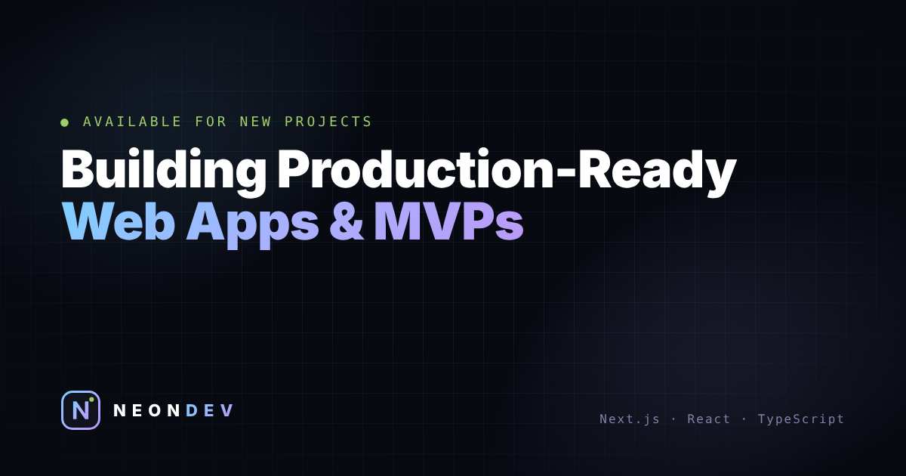

# NEONDEV — Portfolio

Portfolio of **Beqa Tsertsvadze**, Full-Stack & Rapid MVP Developer.
Built with **Next.js (App Router), TypeScript, Tailwind CSS v4 and Zustand**, deployed on **Vercel**.



## Features

- 3D tilt cards with glare and depth layers (`TiltCard`)
- Cursor-following spotlight borders (`.spotlight`)
- Extruded 3D logo that follows the pointer (`Logo3D`)
- Magnetic buttons, custom neon cursor (mouse/trackpad only)
- Text "decrypt" headings, scroll reveal, scroll progress bar
- Canvas particle network + drifting grid background
- Command palette — **Ctrl/⌘ + K**
- Interactive terminal (`help`, `projects`, `skills`, `contact`, `neofetch`, `clear`)
- Case-study pages: `/projects/[slug]`
- SEO: metadata, Open Graph image, JSON-LD, sitemap, robots
- Respects `prefers-reduced-motion`; heavy effects are disabled on touch devices

## Getting started

```bash
npm install
npm run dev        # http://localhost:3000
npm run build      # production build
npm run typecheck  # TypeScript check
```

Requires Node.js 18.18+ (Node 20+ recommended).

## Editing content

All text lives in `src/content/` — no need to touch components:

| File | What it holds |
|---|---|
| `site.ts` | name, role, description, stack, social links, nav |
| `projects.ts` | projects and their case studies |
| `offer.ts` | services, pricing packages, process steps, FAQ |

**Add a project:** put a screenshot in `public/projects/` (16:10, ~1600×1000 JPG), then add an entry to `projects.ts`. The card and the case-study page are generated automatically.

## Contact form

Optional: create a free form at [formspree.io](https://formspree.io), copy its ID and set it as an environment variable:

```
NEXT_PUBLIC_FORMSPREE_ID=your_form_id
```

Without it, the form opens the visitor's email app with the message pre-filled.

## Deploy on Vercel

1. Push this repo to GitHub.
2. On [vercel.com/new](https://vercel.com/new), import the repo — Vercel detects Next.js automatically.
3. (Optional) Add `NEXT_PUBLIC_FORMSPREE_ID` under *Settings → Environment Variables*.
4. After the first deploy, update `site.url` in `src/content/site.ts` to your real domain (used for SEO and Open Graph).

## Structure

```
src/
  app/            layout, home page, /projects/[slug], sitemap, robots, 404
  components/
    effects/      Background, Logo3D, TiltCard, Magnetic, Cursor, DecryptText,
                  Reveal, Terminal, CommandPalette, Misc (clock, marquee, progress)
    sections/     Navbar, Hero, Work, Services, Pricing, Process, About, FAQ, Contact, Footer
    ui/           LogoMark
  content/        editable site data
  hooks/          motion / pointer helpers
  store/          Zustand UI store
```

---

© NEONDEV · BUILD · SHIP · REPEAT
